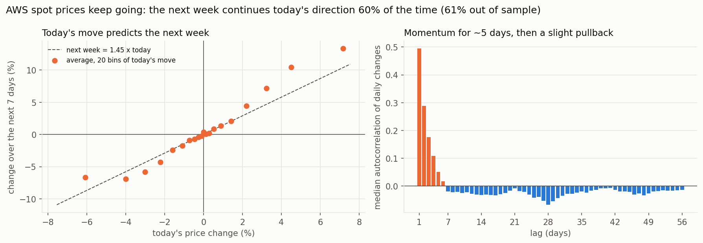
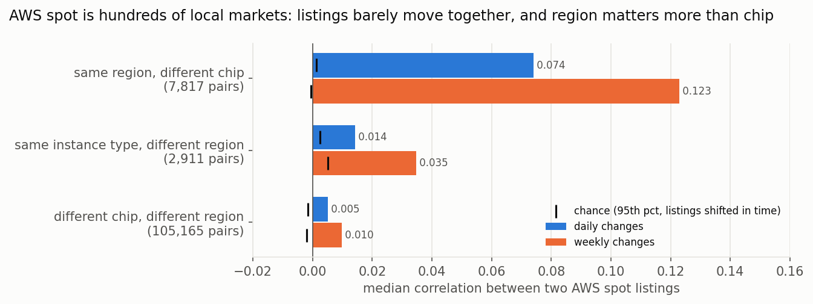
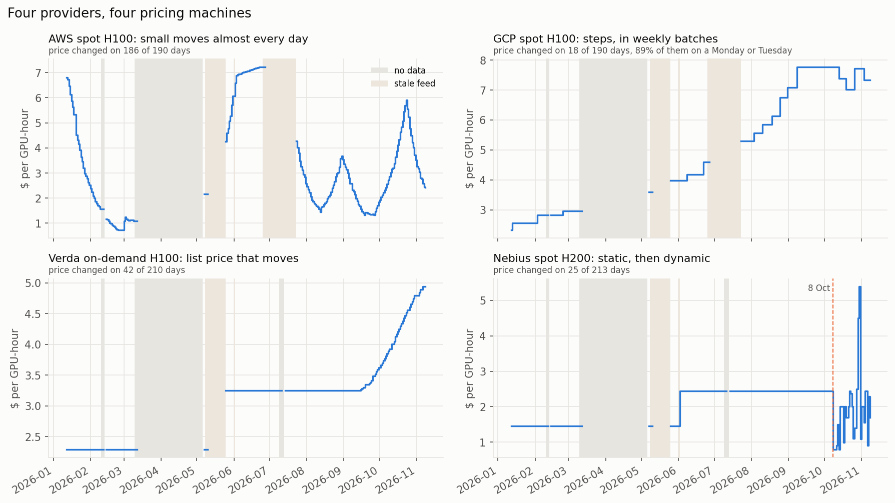
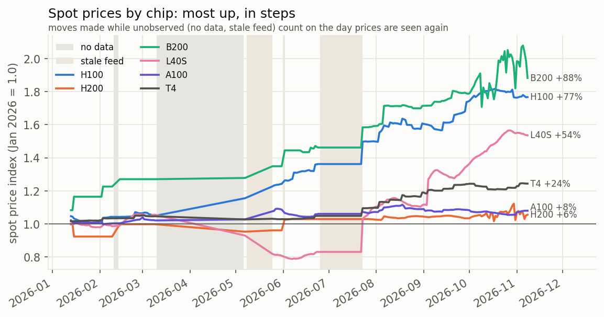

# GPU rental price volatility

I wanted to see if cloud GPU rental prices behave like a financial market, and in particular
whether their volatility clusters (big moves followed by more big moves).

The data is [`afhubbard/gpu-prices`](https://huggingface.co/datasets/afhubbard/gpu-prices):
listed prices from about 15 providers, scraped 1-3 times a day from January to November 2026,
around 3.7M GPU rows.

Mostly they don't. Most providers change prices by hand or on a schedule. The only big market
that reprices every day is AWS spot (~520 listings, changing on 94% of days), so most of this is
about AWS spot.

## AWS spot

### Momentum

Price moves keep going. When a listing moves today, the next 7 days add on average another 1.45x
that move in the same direction. The direction carries on 60% of the time, and about 70% after
big moves. It holds out of sample: fit through August and tested on September to November, it
gives 1.33x and 61%.

Daily changes have an autocorrelation of about 0.5 at lag 1. It fades out by day 5, then goes
slightly negative for a few weeks.



### Forecasting

Since there's momentum, I tried a simple forecast. It's refit every week using only past data,
and compared against assuming the price doesn't change:

| | 1 day | 7 days | 14 days |
|---|---|---|---|
| error vs. "no change" | -15% | -5% | -2% |
| direction right | 71% | 60% | 55% |

That's using today's move only. Adding the previous four days barely helps. It's good enough to
help time spot jobs, but not to predict actual prices.

### Listings barely move together

The same instance type in two different regions has a daily correlation of 0.014. Different
chips in the same region correlate more: 0.074 daily and 0.12 weekly. So region matters more
than chip, which suggests prices follow local capacity. There isn't really one "H100 spot price".



### So does volatility cluster?

The timing of changes clusters, but their size mostly doesn't.

Quiet days come in runs: the chance of a change is 99% after a day with a change, but only 19%
after a quiet day. About a quarter of those quiet days are just spot sitting at the on-demand
price, which it never goes above. H100 and H200 spot are stuck at that cap on 11-12% of days.

Once momentum is taken out, the size of one move barely predicts the next (correlation 0.17,
against 0.14 for shuffled data). GARCH(1,1) finds clustering in 8% of listings, against 5% by
chance.

## Other providers

Every provider prices its own way. GCP reprices spot in weekly batches, usually on Mondays.
Verda moves on-demand prices in runs. Nebius was static until 8 October, then went dynamic. OCI,
Vultr, Cudo and Daytona never changed a price. Providers also don't reprice together: the
correlations between them are no better than chance, even for the same chip.



Spot prices went up over the year. How much depends on whether you count moves that happened
during gaps in the data: H100 spot is up 38% counting only day-to-day changes, and 77% including
the gaps. On-demand prices almost never move day to day. The on-demand increases that did happen
(Lambda raised prices about 14% twice, Verda a couple of times) all fell on days the scraper
missed.



## How it works

- Each listing (provider, instance type, region, spot or on-demand) is its own series. The daily
  price is the snapshot closest to 09:00 UTC.
- Volatility, momentum and clustering use log returns between consecutive days only.
- Listings with identical price paths count once. GCP, for example, copies one price across
  many regions.
- Every clustering result is compared against shuffled data. The shuffles stay within the same
  weekday and month, so weekly schedules don't count as clustering.
- The trend index only uses listings seen on both days. It bridges a gap only when nothing could
  be seen (no data or a frozen feed).

## Data problems

The dataset has a few issues that would distort the results if ignored. `audit.py` checks for
them.

- There's no data at all from 10 March to 7 May, plus a few short outages.
- The feed froze three times: every provider from 8 to 24 May and on 1 June, and AWS and GCP
  from 25 June to 22 July. Frozen snapshots look normal; the only tell is AWS spot not changing.
  I treat those days as missing.
- Snapshot times are irregular, which is why I sample at 09:00.
- There's no availability info (`available` is always true), so you can't see when capacity runs
  out.
- "A100" mixes 40/80 GB and SXM/PCIe cards, and GPU slices are labeled as a whole GPU.
- It's all list prices: no actual transactions or reserved pricing.

It's also only one year, in a rising market. The regional correlation on AWS could partly come
from the scraper fetching one region at a time.

## Running it

```bash
pip install pandas numpy scipy matplotlib pyarrow
python download.py
python analysis.py && python aws_spot.py && python forecast.py
python clustering.py && python event_clustering.py && python market_sync.py && python garch.py
python audit.py && python readme_figures.py
```

`common.py` has the shared loading and cleaning. `aws_spot.py` and `forecast.py` cover the AWS
results above, the other scripts cover the rest, and everything writes to `out/`. Set
`GPUVOL_KEEP_SUSPECT=1` to rerun without the frozen-feed fixes.
