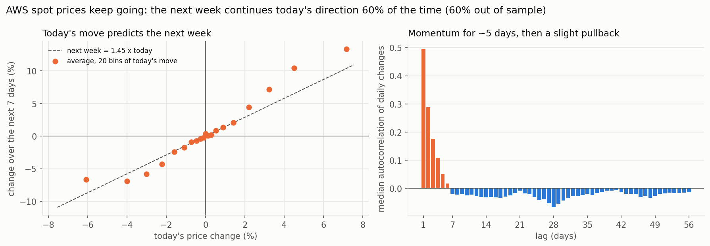
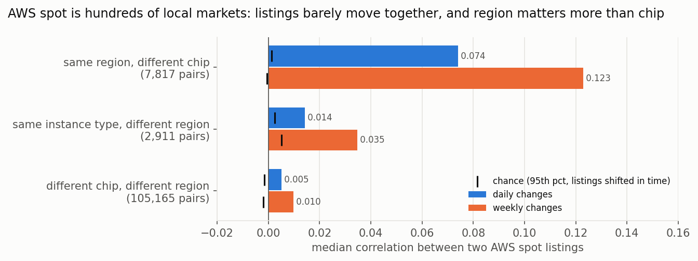
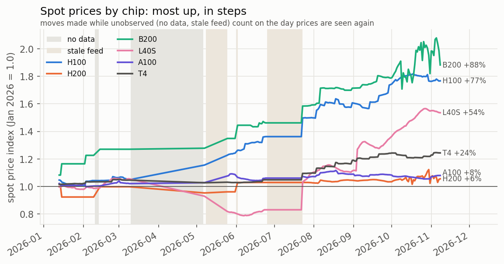

# GPU rental price volatility

Do cloud GPU rental prices behave like a financial market? In particular, does volatility
cluster, with big moves followed by more big moves?

The data is [`afhubbard/gpu-prices`](https://huggingface.co/datasets/afhubbard/gpu-prices): list
prices from about 15 providers, scraped 1-3 times a day from January to November 2026 (~3.7M
rows).

Most providers don't behave like a market at all. They change prices by hand or on a schedule.
The one big market that reprices daily is AWS spot (~520 listings, a change on 94% of days), so
that's most of what follows.

## AWS spot

**Moves keep going.** If a listing moves today, the next 7 days add another 1.45x that move on
average, in the same direction 60% of the time (about 70% after big moves). Daily changes have an
autocorrelation of about 0.5 at lag 1, gone by day 5. The slope fitted through August still works
on September to November: right direction 61% of the time, R² 0.12.



**It's a bit forecastable.** A forecast from today's move, refit weekly on past data only,
compared with assuming no change:

| | 1 day | 7 days | 14 days |
|---|---|---|---|
| absolute error | -14% | -5% | -2% |
| squared error | -2% (not significant) | -9% | -3% |
| direction right | 71% | 60% | 55% |

Squared error is dominated by a few huge jumps nothing predicts. The 14-day column is only tested
from mid-August. Adding more past days barely helps. Good enough to time spot jobs, not to
predict prices.

**Listings barely move together.** The same instance type in two regions correlates at 0.014
daily. Different chips in the same region correlate at 0.074 daily and 0.12 weekly. Region
matters more than chip, which points to local capacity. There's no single "H100 spot price".



**Volatility does cluster, mostly over weeks.** Changes come in runs: there's a 99% chance of a
change after a day with one, and 19% after a quiet day (35% if each listing's days are shuffled
within the month). About a quarter of quiet days are spot sitting at the on-demand price, which
it never goes above. H100 and H200 sit at that cap on 11-12% of days.

Move size clusters too. With momentum removed, consecutive move sizes correlate at 0.17, against
0.00 when shuffled. Shuffling only within each month still gives 0.11, so most of it is calm and
busy stretches lasting weeks, with a smaller day-to-day effect on top. 27% of listings beat the
within-month shuffle (5% expected). GARCH(1,1) only finds 8%, but it fits badly to mostly tiny
moves with the odd jump.

## Other providers

Each one prices its own way. GCP reprices spot in weekly batches, usually on Mondays. Verda moves
on-demand prices in runs. Nebius was static until 8 October, then went dynamic. OCI, Vultr, Cudo
and Daytona never changed a price. Providers don't reprice together, even for the same chip.


Spot prices rose over the year. H100 spot is up 38% counting only day-to-day changes, or 77%
including moves made during data gaps. On-demand barely moves: the increases that did happen
(Lambda about 14% twice, Verda a couple of times) all fell on days the scraper missed.



## Method

- One series per listing (provider, instance type, region, spot or on-demand), priced daily from
  the snapshot closest to 09:00 UTC.
- Volatility and clustering use consecutive-day log returns only. Listings with identical price
  paths count once (GCP copies one price across many regions).
- Clustering is compared against shuffled data, shuffled within the same weekday and month so
  weekly schedules don't count. That also hides month-long swings, so it's a strict test.
- The trend index uses listings seen on both days, and only bridges gaps where nothing could be
  seen.

## Data problems

`audit.py` checks for these.

- No data from 10 March to 7 May, plus a few short outages.
- The feed froze for every provider from 8 to 24 May and on 1 June, and for AWS and GCP from 25
  June to 22 July. Frozen days look normal except that AWS spot stops changing. I treat them as
  missing.
- Snapshot times are irregular.
- `available` is always true, so there's no signal for capacity running out.
- "A100" mixes 40/80 GB and SXM/PCIe cards, and GPU slices are labeled as whole GPUs.
- It's list prices only, over one year in a rising market. The AWS regional correlation could
  partly come from the scraper fetching one region at a time.

## Running it

```bash
pip install pandas numpy scipy matplotlib pyarrow
python download.py
python analysis.py && python aws_spot.py && python forecast.py
python clustering.py && python event_clustering.py && python market_sync.py && python garch.py
python audit.py && python readme_figures.py
```

Shared loading and cleaning is in `common.py`, and everything writes to `out/`. Set
`GPUVOL_KEEP_SUSPECT=1` to rerun without the frozen-feed fixes.
