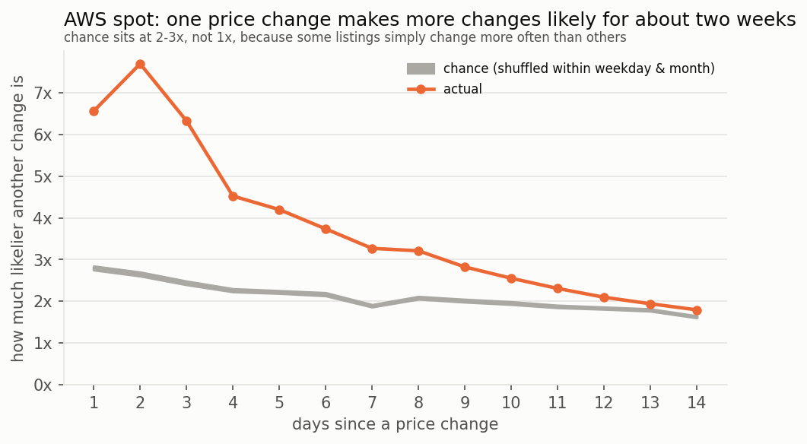
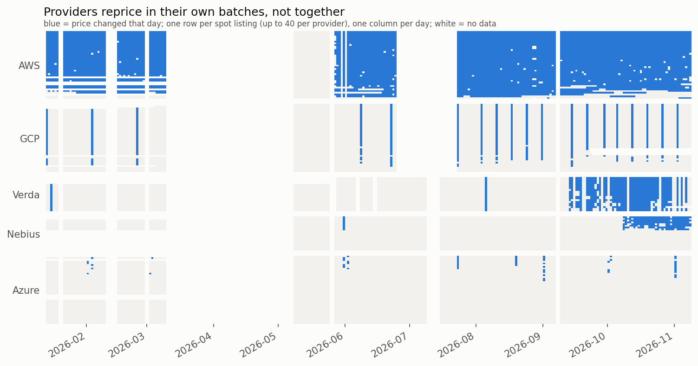

# GPU rental price volatility

How do cloud GPU rental prices move, and does their volatility cluster the way it does in
financial markets?

Data: [`afhubbard/gpu-prices`](https://huggingface.co/datasets/afhubbard/gpu-prices), listed
prices from 13+ providers (AWS, GCP, Azure, OCI, Lambda, RunPod, Nebius, Verda, Vultr, ...),
scraped 1-3 times a day from January to November 2026. About 3.7M GPU listing rows.

## Findings

**Every provider has its own pricing machine.** AWS nudges spot prices almost daily. GCP
reprices in batches, mostly on Mondays. Verda is the only one whose on-demand prices move.
Nebius was static until 8 Oct 2026, then switched to daily dynamic pricing.


OCI, Lambda and Vultr don't move at all.

**Spot moves, on-demand doesn't.** On-demand prices for the major chips moved less than 3% all
year. Spot prices mostly rose, in steps, and not all the same way:


**AWS spot volatility clusters.** A price change makes another one far more likely over the
next two weeks. It's strongest for Hopper chips. The clustering is in many small
moves rather than big jumps, so GARCH only picks up a weak version of it.



**AWS spot prices trend.** Day-to-day returns are strongly autocorrelated (~0.5 at lag 1), which
you wouldn't see in a traded market. Nobody can arbitrage GPU-hours, so nothing removes it.

**Providers reprice alone.** Within a provider, listings change together (pairwise correlation
0.54-0.92). Across providers the links are weak (correlations of 0.26 or less), even for the
same chip.



**Same chip, very different prices.** On a typical day the priciest A100 is ~6.6x the cheapest,
H100 ~4.5x, B200 ~2.6x. Older chips are priced much less consistently.

**Other axes matter less.** GPU tier, region and node size differences mostly reflect which
providers sell what. Most providers charge a flat per-GPU price; 16+ GPU nodes are 8-19% cheaper
per GPU.

## Method

- One series per listing (provider, instance, region, spot/on-demand, config); daily log returns
  on consecutive days only.
- Volatility split into how often a price changes and how big the change is, since prices sit
  flat and then jump.
- Trends use a matched-listing index (only listings present on both days), so listings coming
  and going don't move it.
- Listings that move in lockstep (one price copied across regions or node sizes) are counted
  once. Listings that never move are all kept.
- Clustering tests are compared against shuffles within the same weekday and 30-day block, so
  weekly schedules and slow regime changes don't count.
- AR filter, Ljung-Box and GARCH(1,1) are written out by hand (numpy/scipy) to handle missing
  days.

## Data quirks

FYI, `audit.py` checks for these: GCP reprices in Monday batches and copies one price across
many regions, and Nebius changed pricing systems on 2026-10-08. The AWS and GCP feeds froze from
2026-06-25 to 2026-07-22 and caught up in one jump on 07-23; the frozen days are treated as
missing, and the jump counts toward trends but not volatility. 2026-05-25 (a RunPod catalog
swap) is excluded, and the dataset has no snapshots from 2026-03-10 to 2026-05-07.

## Caveats

List prices only: no transactions, volumes or reserved contracts. About 230 days, all in a
rising market. Listings are equally weighted, so AWS and GCP dominate.

## Files

| File | |
|---|---|
| `download.py` | fetch the dataset into `data/` |
| `analysis.py` | volatility by axis, price indexes, cross-provider spreads |
| `clustering.py` | autocorrelation and Ljung-Box tests |
| `event_clustering.py` | do price changes come in bursts? |
| `market_sync.py` | do listings and providers reprice together? |
| `garch.py` | GARCH(1,1) with calibrated significance |
| `audit.py` | checks for scraper and schedule artifacts |
| `common.py` | shared loading and cleaning |
| `readme_figures.py` | the charts in this README (`docs/img/`) |

Results and charts go to `out/`. Set `GPUVOL_KEEP_SUSPECT=1` to rerun with the excluded days
kept (outputs in `out/with_suspect_days/`).

```bash
pip install pandas numpy scipy matplotlib pyarrow
python download.py
python analysis.py
python clustering.py && python event_clustering.py && python market_sync.py && python garch.py
python readme_figures.py
```
